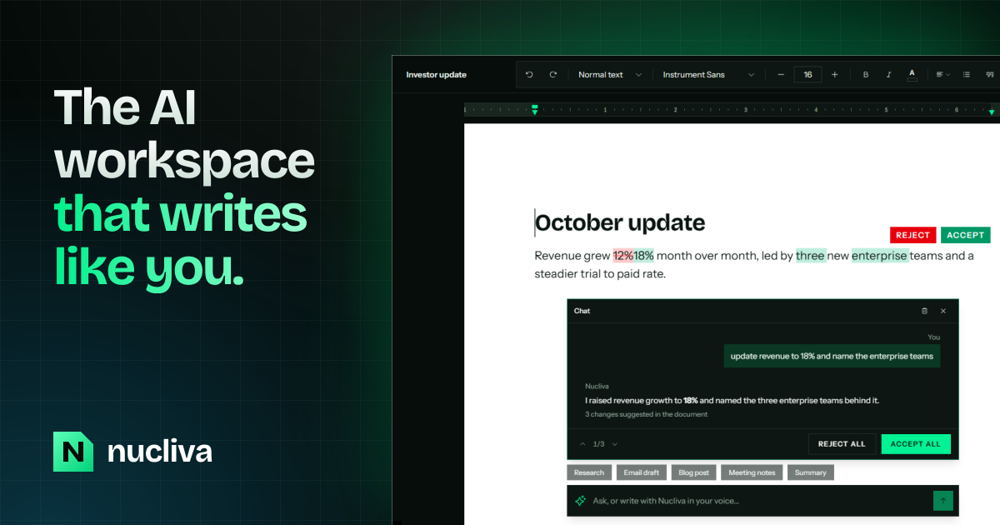
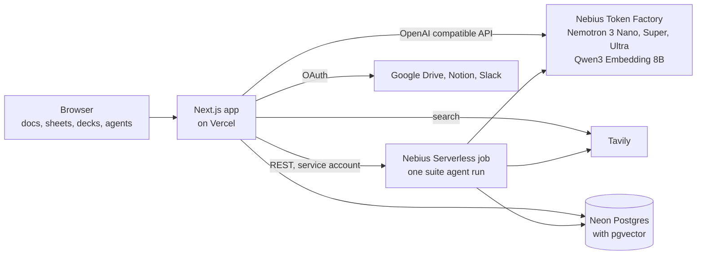

# Nucliva

### [nucliva.com](https://nucliva.com)



An AI writing workspace that writes in your voice. Docs, slides and sheets in one place, with an assistant that researches the web, drafts, keeps your facts consistent, and shows its work as changes you can accept, reject or undo.

Built for the Nebius x NVIDIA Global AI Hackathon. Every model call runs on NVIDIA Nemotron through Nebius Token Factory, and web research runs on Tavily.

## Features

- **Docs editor.** A Lexical page editor with styles, lists, quotes, tables, alignment, indentation, a Google Docs style ruler with margins and tab stops, and zoom.
- **AI chat and edits.** Ask for a change and it lands in the document as green and red suggestions, down to single words, each with its own Accept and Reject, plus Accept All and Reject All. Chat history is saved per document as a tree, so you can go back, edit, branch and copy.
- **Writes in your voice.** Add samples of your own writing on the Style Profile page. Nucliva reads their tone (formality, sentence structure, vocabulary) and every draft matches it.
- **Web research.** Ask it to research something and it searches with Tavily, shows the sources as it finds them, and cites them with numbered links when you ask.
- **Knowledge base.** Upload PDFs, text and Markdown, or connect Google Drive, Notion and Slack. Everything is embedded into pgvector, and drafts and agents draw on the passages that match the request. See [Knowledge base connectors](#knowledge-base-connectors).
- **The ripple.** Change a number, amount, percentage or date, and every other place in the document that states it changes to match, each written the way that place writes it (`$4.2M` stays short, `$4,200,000` stays long). Dates that follow from other dates are recalculated. There is nothing to accept: each ripple goes in a log in the toolbar, where one click puts it back. See [How the ripple works](#how-the-ripple-works).
- **Suite agents.** Ask for something like "Q3 investor update" and an agent plans it, researches it, matches your voice, then writes a doc, a sheet and a deck with the same facts. The three are linked to each other and arrive as suggestions to accept. Each run is a Nebius Serverless job. See [Suite agents on Nebius Serverless](#suite-agents-on-nebius-serverless).
- **Inline autocomplete.** Ghost text as you type, from Nemotron Nano, accepted with Tab.
- **Sheets and slides.** A spreadsheet on FortuneSheet and a slide designer with a presenter mode.
- **Sandbox and tours.** A no-signup sandbox for every solution, and an interactive tour for guests and for new accounts. See [Try it](#try-it).
- **Accounts.** Email and password, plus Google and GitHub sign in.

## Architecture



- The **web app** serves the editors and the API routes: drafting, research, autocomplete, fact reading for the ripple, the knowledge base and agent runs.
- **Nebius Token Factory** serves every model. The app never calls a model anywhere else.
- **Tavily** grounds research drafts and agent runs in the live web.
- **Neon Postgres** holds documents, writing samples, agent runs and knowledge sources, and **pgvector** holds their embeddings for retrieval.
- **Nebius Serverless** runs each suite agent in its own container, which writes its progress and its files to the database while the page follows along.

## NVIDIA Nemotron and Nebius

Every model Nucliva calls is an open model served by [Nebius Token Factory](https://tokenfactory.nebius.com). The client is in [`apps/web/lib/ai/nebius.ts`](apps/web/lib/ai/nebius.ts).

### Which Nemotron model does what

The three sizes of NVIDIA Nemotron 3 are matched to the job: the smallest where speed matters, the largest where writing quality does.

| Model | Used for | Where |
| --- | --- | --- |
| **Nemotron 3 Nano** (30B, 3B active) | Inline autocomplete, with thinking turned off so it comes back fast | [`app/api/autocomplete/route.ts`](apps/web/app/api/autocomplete/route.ts) |
| **Nemotron 3 Super** (120B, 12B active) | Reading facts out of paragraphs for the ripple, and rewriting the sentences that lean on a changed fact | [`lib/ai/read-facts.ts`](apps/web/lib/ai/read-facts.ts) |
| | Analyzing the tone of your writing samples | [`lib/ai/style-engine.ts`](apps/web/lib/ai/style-engine.ts) |
| | Planning a suite agent run, and turning its doc into a sheet and a deck with the same numbers | [`lib/agents/suite.ts`](apps/web/lib/agents/suite.ts) |
| **Nemotron 3 Ultra** (550B, 55B active) | Everything written for you: chat edits, research drafts, and the suite agent's doc, in your voice | [`lib/ai/style-engine.ts`](apps/web/lib/ai/style-engine.ts), [`lib/agents/suite.ts`](apps/web/lib/agents/suite.ts) |
| **Qwen3 Embedding 8B** | Embedding writing samples and knowledge base sources into pgvector | [`lib/ai/embeddings.ts`](apps/web/lib/ai/embeddings.ts) |

### Where Token Factory sped the work up

- **One endpoint for every model.** Token Factory speaks the OpenAI API, so LangChain's standard client works with only a base URL change. Moving a feature from one Nemotron size to another is a one-word change (`getChatModel("nano" | "super" | "ultra")`), which made it quick to try each job on each size and keep the one that was fast enough and good enough.
- **Thinking on or off per call.** Nemotron reasons before it answers unless told not to. Token Factory passes `enable_thinking: false` through to the model's chat template, so autocomplete and fact reading skip it and answer quickly, while the writing models keep it.
- **Structured output.** Edits, extracted facts, tone markers, agent plans, sheets and decks all come back as JSON that matches a Zod schema, through the same API.
- **Embeddings in the same place.** The embedding model runs on the same account and key as the chat models, so there is one provider to set up.

### How fast is autocomplete?

`apps/web/scripts/latency-bench.mts` times the call the editor makes for ghost text (Nemotron 3 Nano, thinking off, the same prompt) on five half-written sentences, and with `--thinking` the same call with thinking on.

```bash
cd apps/web
pnpm dlx tsx scripts/latency-bench.mts --runs 10              # 50 calls (needs NEBIUS_API_KEY)
pnpm dlx tsx scripts/latency-bench.mts --runs 4 --thinking    # also with thinking on
```

Measured on October 24, 2026 from a home connection, model round trip only:

| Nano | Calls | Median | p90 | Min | Max |
| --- | --- | --- | --- | --- | --- |
| Thinking off (what autocomplete uses) | 50 | 694ms | 795ms | 477ms | 1060ms |
| Thinking on | 20 | 10752ms | 14400ms | 4710ms | 21266ms |

Turning thinking off makes the suggestion about 15 times faster, which is the difference between ghost text that keeps up with typing and ghost text that arrives after you have moved on. Network and load vary, so run it again before quoting it.

### Other Nebius services

- **Nebius Serverless AI jobs.** Suite agents run in the background as Serverless jobs: one container per run, started through the Nebius REST API with a service account. See [Suite agents on Nebius Serverless](#suite-agents-on-nebius-serverless).

## Built with

- **Models:** NVIDIA Nemotron 3 (Nano, Super and Ultra) and Qwen3 Embedding 8B, served on [Nebius Token Factory](https://tokenfactory.nebius.com)
- **Background agents:** [Nebius Serverless AI](https://docs.nebius.com/serverless/overview) jobs
- **Web grounding:** [Tavily](https://tavily.com)
- **Orchestration and tracing:** LangChain and LangSmith
- **App:** Next.js 16 (App Router), React 19, Tailwind CSS v4, shadcn/ui on Base UI
- **Editors:** Lexical for docs, FortuneSheet for sheets, a custom slide designer
- **Auth:** Better Auth, with a guest mode for the sandbox
- **Data:** Neon Postgres with pgvector, via Drizzle ORM
- **Monorepo:** pnpm workspaces and Turborepo, checked with Ultracite (Biome)

## Layout

```
apps/web                   the Next.js app
apps/web/lib/ai            models, prompts, embeddings, research
apps/web/lib/agents        the suite agent and its Nebius jobs
apps/web/lib/knowledge     uploads and the Drive, Notion and Slack connectors
apps/web/lib/editor        facts and the math behind the ripple
apps/web/scripts           evaluations, benchmarks and the agent job entry
packages/db                Drizzle client, schema and migrations
packages/ui                shared shadcn components and styles
agent.Dockerfile           the container each agent job runs
```

## Getting started

You need Node 20 or newer and [pnpm](https://pnpm.io).

```bash
pnpm install
cp apps/web/.env.local.example apps/web/.env.local
```

Fill in `apps/web/.env.local`:

| Variable | What it is |
| --- | --- |
| `DATABASE_URL` | Neon Postgres connection string (pooled) |
| `BETTER_AUTH_SECRET` | any long random string |
| `BETTER_AUTH_URL`, `NEXT_PUBLIC_APP_URL` | the app URL, `http://localhost:3000` locally |
| `NEBIUS_API_KEY` | a Nebius Token Factory key |
| `TAVILY_API_KEY` | a Tavily key |
| `GOOGLE_CLIENT_ID`, `GOOGLE_CLIENT_SECRET` | Google sign in, and the Google Drive connector (optional) |
| `GITHUB_CLIENT_ID`, `GITHUB_CLIENT_SECRET` | GitHub sign in (optional) |
| `NOTION_CLIENT_ID`, `NOTION_CLIENT_SECRET` | the Notion connector (optional) |
| `SLACK_CLIENT_ID`, `SLACK_CLIENT_SECRET` | the Slack connector (optional) |
| `NEBIUS_PROJECT_ID` and the other `NEBIUS_*` job keys | running agents on Nebius Serverless (optional, see below) |
| `LANGSMITH_*` | LangSmith tracing (optional) |

Set up the database, then start the app:

```bash
pnpm db:migrate
pnpm dev
```

Open http://localhost:3000.

In production, set `BETTER_AUTH_URL` and `NEXT_PUBLIC_APP_URL` to the site's address (for nucliva.com, `https://nucliva.com`). Sign in callbacks are `<app URL>/api/auth/callback/google` and `<app URL>/api/auth/callback/github`, and each must be added to that provider's OAuth settings.

## Scripts

```bash
pnpm dev            # run the app
pnpm build          # production build
pnpm typecheck      # type check every package
pnpm lint           # check with Ultracite (Biome)
pnpm format         # fix formatting
pnpm db:generate    # write a migration after a schema change
pnpm db:migrate     # apply migrations
pnpm db:studio      # browse the database
```

## Suite agents on Nebius Serverless

A run goes through seven steps, and the Agents page shows each one as it happens:

1. **Plan** with Nemotron Super, using your knowledge base.
2. **Research** with Tavily, up to four searches.
3. **Voice**, from your writing samples in pgvector.
4. **The doc** with Nemotron Ultra, in your voice, with cited sources.
5. **The sheet** and 6. **the deck** with Nemotron Super, made from the doc so the numbers match.
7. **Linking** the three files, which then point to each other.

The doc arrives as suggestions to accept one by one, and the sheet and deck with Accept and Reject.

The run itself is a container that does one run and stops: [`agent.Dockerfile`](agent.Dockerfile) runs [`apps/web/scripts/agent-run.mts`](apps/web/scripts/agent-run.mts). When the app starts a run it creates a [Nebius Serverless AI job](https://docs.nebius.com/serverless/jobs/manage) for it through the REST API, signed in as a service account, and follows the job's state while the run writes its progress to the database. Until Nebius is set up, or if it will not take the job, the run happens on the web server instead, and the page says which.

To set it up:

1. Build and push the image from the root of the repository: `docker build -f agent.Dockerfile -t <registry>/nucliva-agent:latest .`, then `docker push` it to a registry Nebius can pull from.
2. In Nebius AI Cloud, create a service account in a group that may create Serverless jobs, and an [authorized key](https://docs.nebius.com/iam/service-accounts/authorized-keys) for it.
3. Set these on the web app:

| Variable | What it is |
| --- | --- |
| `NEBIUS_PROJECT_ID` | the project the jobs run in |
| `NEBIUS_SERVICE_ACCOUNT_ID` | the service account |
| `NEBIUS_AUTHORIZED_KEY_ID` | its authorized key |
| `NEBIUS_PRIVATE_KEY` | the key's private PEM, with line breaks written as `\n` |
| `NEBIUS_AGENT_IMAGE` | the image from step 1 |
| `NEBIUS_AGENT_PLATFORM`, `NEBIUS_AGENT_PRESET` | optional, `cpu-d3` and `4vcpu-16gb` by default |
| `NEBIUS_SUBNET_ID` | optional, the project's default subnet otherwise |
| `NEBIUS_SECRET_ID` | optional, a MysteryBox secret holding `DATABASE_URL`, `NEBIUS_API_KEY`, `TAVILY_API_KEY` and `LANGSMITH_API_KEY`, so they are not written into each job |

Without `NEBIUS_SECRET_ID`, those keys are passed to the job as plain environment variables.

## Knowledge base connectors

The Knowledge Base page brings outside material in, so drafts and agents can draw on it. Everything is split into chunks and embedded into pgvector, and each draft looks up the passages that match the request.

- **Local files:** upload PDFs, text, Markdown or CSV. No setup.
- **Google Drive:** the 25 most recent Docs, Slides, Sheets and text files, read only.
- **Notion:** the pages the user shares with the integration when they connect.
- **Slack:** recent messages from up to 10 public channels the user is in.

Each connected app has **Sync now** and **Disconnect**, and disconnecting removes what it brought in. Each app needs an OAuth app of its own. The redirect URL for each is `<app URL>/api/integrations/<provider>/callback`, where the provider is `google_drive`, `notion` or `slack`.

| App | Set up | Variables |
| --- | --- | --- |
| Google Drive | In the Google Cloud project used for sign in, enable the Google Drive API, add the `drive.readonly` scope to the consent screen, and add the redirect URL to the OAuth client | uses `GOOGLE_CLIENT_ID` and `GOOGLE_CLIENT_SECRET` |
| Notion | Create a public integration at notion.so/my-integrations with read content capability, and add the redirect URL | `NOTION_CLIENT_ID`, `NOTION_CLIENT_SECRET` |
| Slack | Create an app at api.slack.com/apps, add the user token scopes `channels:read` and `channels:history`, and add the redirect URL (Slack needs HTTPS) | `SLACK_CLIENT_ID`, `SLACK_CLIENT_SECRET` |

An app without its keys shows **Needs setup** on its card instead of Connect.

## How the ripple works

A model understands, and code does the math.

1. **Reading.** In the background, each paragraph that looks like it has a fact in it is read by Nemotron Super, which says what each fact is called and where the paragraph states it. Paragraphs are read one at a time, so each one knows the facts found before it, and the same fact written two ways is linked. The answer is checked in code: every value is read from the words, not taken from the model.
2. **Noticing.** When you change a fact, by typing over it or selecting it and typing, the new value is read from the text once you move on or pause.
3. **Rippling.** Every other place that states the same fact is rewritten in that place's own format. Facts worked out from others, like dates, are recalculated in code. A model never does the arithmetic.
4. **Applying.** The changes go in at once, with nothing to accept, so one edit never leaves dozens of prompts behind. Sentences that lean on a fact without stating it are rewritten by the model and go in too. Every ripple is recorded in the **ripple log** in the toolbar, saved with the document, where one click puts it back. Undo works as well.

The facts a document has, and its ripple log, are saved with it.

### How well does it work?

`apps/web/scripts/ripple-eval.mts` runs two test documents through the same code the editor uses. In one, Q3 revenue is written five ways next to a different `$4.2M`. In the other, a beta date is worked out from a launch date. It changes one fact in each, and checks the changes it makes against the right ones.

```bash
cd apps/web
pnpm dlx tsx scripts/ripple-eval.mts --runs 5    # with the model (needs NEBIUS_API_KEY)
pnpm dlx tsx scripts/ripple-eval.mts --offline   # the code alone, no model
```

With the model, over 5 runs: **30 of 30 changes were correct** (precision 100%, recall 100%), and the different `$4.2M` was never touched. That is two small documents, so read it as a check that the idea holds, not as a measure of every document. Pass `--verbose` to see what the model said about each paragraph.

## Try it

There is no shared demo login. Open [nucliva.com](https://nucliva.com) and press **Try the sandbox**, or press **Try it now** on any page under `/solutions` (for example `/solutions/founders/investor-updates`). Either one opens a sandbox with no sign up: a guest account with a lived-in workspace for that line of work, with earlier documents, a deck, a sheet, writing samples and a knowledge base. You land in a document of rough notes with a request already typed in.

An interactive tour takes over from there. It dims everything except the thing to use and waits for you to do each step:
- send the request, then accept or reject what comes back
- add an example and change a number, so the ripple updates the other lines
- open the ripple log
- open another file
- start an agent run
- look at Style Profile and Knowledge Base

Every step can be skipped, and the **Tour** button brings it back. A new account gets its own tour, which starts from an empty workspace: add a writing sample, run an agent, then write, review and ripple in a doc of your own.

If you sign up from the sandbox, your work moves to your account. Guests have a small hourly allowance of AI requests and cannot connect outside apps.

## Not done yet

- A ripple changes one document. Carrying it into the linked sheet and deck is next.
- The slides and sheets editors are basic next to the docs editor.
- The editor's layout on phones is rough.
- There are no automated tests besides the ripple evaluation.
- OAuth tokens for connected apps are stored unencrypted.

## License

[MIT](LICENSE.md)
